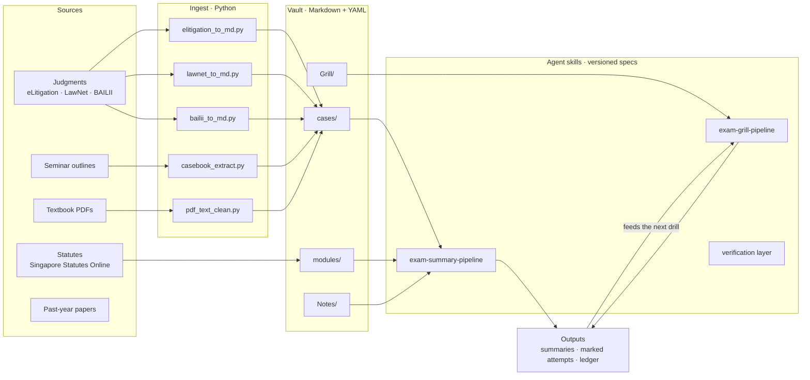

# Law Vault

**A local-first, agent-operated knowledge system for law school.**

Obsidian · Markdown · YAML · Python · versioned agent skills

> This is the **public showcase** of a private working vault. The architecture, skill specs, templates, tooling and rubrics are the real ones, used daily. The copyrighted and personal corpus — textbook PDFs, seminar outlines, past-year papers, the full case library and marked attempts — is excluded by design. See [docs/SCOPE-AND-EXCLUSIONS.md](docs/SCOPE-AND-EXCLUSIONS.md).
>
> Skill specs reference paths inside the private vault (for example `modules/CL1_Contract/Summaries/`). Those files are not published here; the specs are included so the method can be reviewed.

---

## The problem

Law school produces a specific kind of information overload: hundreds of case notes, statutory provisions, textbook chapters, seminar outlines and past papers — all interconnected, all needed under exam conditions.

Generic chat assistants fail at this for three reasons:

1. **They forget the corpus.** Context windows are not a case library.
2. **They hallucinate citations.** A reversed rule or a wrong section number is worse than no answer.
3. **They cannot be audited.** There is no diff, no source trail, no way to check the work.

This vault is the answer I built: one Markdown graph the agent reads from, plus versioned skill specs that govern *how* it reads, writes, cites and marks — with hard rules against fabrication.

## What the system does

**1. Ingest — deterministic, not generative.**
Python converters turn judgments and statutes into faithful Markdown: YAML frontmatter, preserved paragraph numbers `[n]`, preserved headings and block quotes. The model never retypes a judgment from memory; it reads a file that still matches the source.

**2. Synthesise — exam-summary pipeline.**
For each week, a skill spec walks the agent through the textbook chapter, the seminar outline, the case notes and the statute bank, and produces a mini-textbook: rule statements, case ledger, I/R/A pre-writes and typing-drill packs. Every proposition carries a case pinpoint, textbook paragraph or statutory section.

**3. Perform — grill pipeline.**
Timed attempts are marked against a rubric distilled from the course's own marking standards. Every error goes into an **error ledger**; the same error twice becomes the next session's drill. The loop is: attempt → mark → ledger → drill → re-attempt.

**4. Verify.**
`AGENTS.md` is the constitution: vault first, outside sources only when the vault falls short, cite everything, stop and ask when material is missing. Scripts check that quoted passages actually appear in the judgment and that cited paragraph numbers exist.

## Architecture

## Repository map

| Path | What it is |
|---|---|
| [`AGENTS.md`](AGENTS.md) | The operating rules every agent session inherits — verification, sourcing, citation. |
| [`.opencode/skills/`](.opencode/skills/) | **15 skill specs.** Frontmatter declares triggers and allowed tools; the body is a procedure with an output contract. |
| [`_templates/`](_templates/) | 6 note schemas: case note, statute note, topic note, IRAC answer, essay outline, LEGO block. |
| [`_tools/`](_tools/) | 15 tools: converters, citation verifiers, and the case-collection architecture doc. |
| [`_integrity/`](_integrity/) | Citation guide, verification checklist, anti-plagiarism policy. |
| [`_research/`](_research/) | Research hub and case-finding pipeline. |
| [`Grill/`](Grill/) | Marking rubrics, the style standard, and the error-ledger template. |
| [`cases/`](cases/) · [`modules/`](modules/) · [`Notes/`](Notes/) | The corpus skeleton, with one sample artefact in each populated folder. |
| [`docs/`](docs/) | Architecture, workflow, data model, vault map, and scope notes. |

## Design principles

1. **Local-first, plain text.** No proprietary database. Every note is Markdown with YAML frontmatter — greppable, diffable, portable, and readable by any agent.
2. **The vault is the retrieval layer.** Cases, statutes and notes are structured so the agent *reads* instead of *recalls*. Retrieval quality is a schema problem before it is a model problem.
3. **Citation or nothing.** Every legal proposition carries a case pinpoint, textbook paragraph or statutory section. A claim without a citation is not allowed in the output.
4. **Deterministic where possible, generative where necessary.** Conversion, paragraph numbering and citation checks are Python. Judgment — synthesis, issue-spotting, marking — is the model's job.
5. **Separate source from corpus.** Git tracks text. Copyrighted PDFs, personal AI data and marked attempts stay out of the repository — by `.gitignore` rule, not by discipline.
6. **Skills are versioned specs, not prompts.** Each `SKILL.md` has a trigger, a materials map, a procedure, an output contract and failure modes. It can be reviewed, diffed and improved like code.
7. **Closed feedback loop.** Every marked attempt writes to an error ledger. Repeated errors become drills. The system gets sharper at the specific things I get wrong.

## By the numbers

The private vault at the time of writing:

- **140+ commits**, **600+ tracked files**
- **237 case Markdown files** and 23 judgment PDFs
- **15 agent skills**, 6 templates, 15 tools
- **4 modules**: Contract Law, Criminal Law, Legal Research & Writing, Singapore Legal System
- **5 statute banks** transcribed from Singapore Statutes Online

This showcase repo carries the engine — 73 files — not the corpus.

## Start here

- [Vault map](docs/VAULT-MAP.md) — the full folder structure and scale, with file titles withheld.
- [Architecture](docs/ARCHITECTURE.md) — layers, folder layout, why one vault instead of a database.
- [Workflow](docs/WORKFLOW.md) — the four loops, with the actual commands.
- [Data model](docs/DATA-MODEL.md) — frontmatter schemas, tag taxonomy, naming rules.
- [Scope and exclusions](docs/SCOPE-AND-EXCLUSIONS.md) — what is deliberately not here, and why.

## Status

Contract Law is the mature pipeline (Weeks 1–4 and 7 built end-to-end, with the Week 7 chapter as the exemplar). Criminal Law is in progress. The skill format is stable; new modules reuse it.

## Citation

If you use or adapt this system, cite it via [CITATION.cff](CITATION.cff).

## Security

See [SECURITY.md](SECURITY.md). Please report vulnerabilities privately, not in a public issue.

## Contributing

See [CONTRIBUTING.md](CONTRIBUTING.md). Small fixes are welcome; DCO sign-off required.

## Licence

- **Code** (`_tools/` and script files): MIT — see [LICENSE](LICENSE).
- **Written content** (notes, templates, rubrics, documentation, skill prose): © Steven Chu, all rights reserved. Short quotations with attribution are welcome; for anything more, open an issue.
- **Third-party material** — statutes, judgments and textbook PDFs — is not relicensed here. See [NOTICE](NOTICE).
