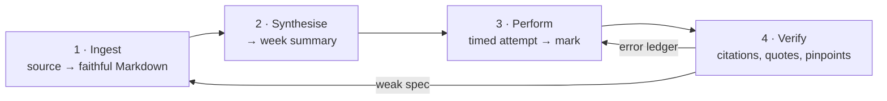

# Workflow

Four loops. They share one corpus and one rule set — `AGENTS.md`.



## Loop 1 — Ingest

The goal is a case note that still matches the judgment: same paragraph numbers, same quotations, same structure. The converter does the transcription; the model writes only the brief.

### Singapore judgments — eLitigation

```bash
python3 _tools/elitigation_to_md.py <url> "cases/CL1_Contract/wk_7/<Case Name> [2023] SGHC 203.md"
```

Preserves metadata, three heading levels, numbered paragraphs and block quotes. The output carries YAML frontmatter with the citation and source URL for traceability.

### Singapore judgments — LawNet

LawNet is used when eLitigation serves abridged text (paragraph numbers present, bodies empty — and nothing on the page says so). The browser step dumps `body.innerText`; the converter normalises it:

```bash
python3 _tools/lawnet_to_md.py <raw.txt> "cases/CRL_Criminal/wk_7/<Case Name>.md" --module CRL --week 7
```

### UK / Commonwealth — BAILII

BAILII uses at least three different markups, so there are two converters:

```bash
python3 _tools/bailii_to_md.py <in.html> <out.md> --module CRL --week 7 --jurisdiction UK
python3 _tools/bailii_plain_to_md.py <in.html> <out.md> --module CL1 --week 10 --style lords
```

BAILII is bot-walled; the browser step runs headed, waits for the proof-of-work challenge to clear, then saves the HTML. See `_tools/BROWSER.md`.

### Casebook extracts

For pre-digital cases that are not on BAILII, the fallback is the casebook extract the outline cites:

```bash
python3 _tools/casebook_extract.py   # repairs OCR ligature breaks in Burrows / McKendrick
python3 _tools/pdf_text_clean.py     # strips SAL textbook running heads and line numbers
```

### Then the brief

```bash
python3 _tools/case_note_tools.py scaffold "cases/CL1_Contract/wk_7/<file>.md"
python3 _tools/verify_brief.py       "cases/CL1_Contract/wk_7/<file>.md"
```

`verify_brief.py` checks three things mechanically:

1. The `## Judgment` section is byte-identical to the committed version — a brief is added *above* the judgment, never inside it.
2. Every paragraph number cited in the brief exists as a `**[n]**` marker in the judgment.
3. Every substantive blockquote appears verbatim in the judgment.

Quotation drift is the failure mode that matters most: a paraphrase inside quotation marks is worse than no quotation, because it looks authoritative.

## Loop 2 — Synthesise (weekly exam summary)

**Trigger:** "Week N exam summary", "cheatsheet for Chapter N", "continue the exam summary series".

**Materials, in order:**

1. Textbook chapter (private PDF) — the spine.
2. Seminar outline (private) — the scope, and every question that must be answerable.
3. Case notes for the week — the authorities, with pinpoints.
4. Statute bank in `modules/<module>/Statutes/` — verified against SSO.
5. The previous week's summary — for voice and structure.

**Output:** one file per week, following the Week 7 exemplar. The fixed sections are:

- **Scope and exam relevance** — what the chapter is for, what it is not.
- **Rule statements** — the law, with authority on every sentence.
- **Case ledger** — case, material facts, holding, pinpoint, one-line use.
- **I/R/A pre-writes** — issue, rule and application blocks that can be typed from memory.
- **Typing-drill packs** — the blocks to rehearse under time.
- **Traps** — the distinctions that cost marks (gateway vs factor; element vs factor; rule vs implication).

**Verification before the summary is accepted:**

- Every case citation resolves to a note in `cases/`.
- Every statutory section resolves to the statute bank, and the bank matches SSO.
- Every textbook reference is a real paragraph number.
- Nothing is marked `[CHECK]` in the final file.

## Loop 3 — Perform (grill)

This is the loop that turns notes into marks.

### Drill menu

| ID | Drill | Time | What it trains |
|---|---|---|---|
| D1 | Type-drill — blind-type one pre-write block against a timer | 10 min | Making stock parts cost zero thinking |
| D2 | Issue-spot blitz — fresh hypo, issues only, no prose | 10–12 min | Issue identification and priority |
| D3 | Second-half drill — given the rule, write only the application | 25–35 min | Analogy, distinction, weighing, conclusion |
| D4 | Timed attempt — full question under exam conditions | 90 min | Everything |
| D5 | Rewrite — redo the weakest block from scratch | 15 min | Correction under time |
| D6 | Style pass — apply the style standard sentence by sentence | 10 min | Compression and clarity |

### Marking

A marked attempt produces four things:

1. **Scoreboard** — criterion → band → one-line reason, using the rubric's own band descriptors.
2. **Top three fixes**, each quoting the offending line from the attempt.
3. **The next drill** for each fix.
4. **Ledger entries** — one row per error.

The rubric is distilled from the course's marking standards: legal analysis 40%, organisation 25%, writing 30%, with the remaining weight on presentation. The point of marking against a fixed rubric is that the feedback is comparable across weeks — I can see whether the same weakness is receding.

### The error ledger

`Grill/CL1_Contract/error-ledger.md` — one row per error:

| Date | Drill | Topic | Error | Correct move | Fix drill | Status |
|---|---|---|---|---|---|---|
| 2026-10-13 | D4 Q1(b)(i) | Pay-more variation | Stopped at *Stilk*; missed *Roffey* practical benefit + duress check | Six limbs: benefit, no duress → variation likely binding | Bank T9; redo in 8 min | open |

**Rule: the same error twice becomes the next session's drill, drilled to death.** The ledger is the memory of the system; without it, the same mistake recurs in a new disguise.

## Loop 4 — Verify

Before anything is relied on in assessed work:

```bash
python3 _tools/verify_case_note_citations.py   # quotes and pinpoints against the judgment
python3 _tools/verify_brief.py <note.md>       # brief vs judgment body
```

Then the human checks:

- [ ] `_integrity/VERIFICATION_CHECKLIST.md` — every proposition has a source.
- [ ] `_integrity/CITATION_GUIDE.md` — citation format is consistent.
- [ ] `_integrity/ANTI_PLAGIARISM_GUIDE.md` — the boundary between assistance and authorship.
- [ ] `_tools/librarian.md` — no orphaned cases (Dataview surfaces missing tags, modules, citations).

## Division of labour

| Task | Human | Agent |
|---|---|---|
| Choosing the source and the scope | ✔ | |
| Transcribing a judgment | | ✔ (script) |
| Writing the brief and the ratio | | ✔ (verified against the judgment) |
| Deciding what is examinable | ✔ | |
| Building the summary structure | | ✔ (spec) |
| Marking an attempt | | ✔ (rubric) |
| Accepting the mark and choosing the next drill | ✔ | |
| Final citation and integrity check | ✔ | ✔ (script) |

## A worked week

Week 7 — Regulation of Terms:

1. **Ingest.** Five case notes converted from eLitigation/LawNet; each briefed and verified. UCTA 1977 and CPFTA 2003 transcribed from SSO into the statute bank.
2. **Synthesise.** The chapter summary built against the seminar outline: incorporation, construction, UCTA, CPFTA, the *Nail Palace* / *Speedo* line. Case ledger and pre-writes written.
3. **Perform.** Two timed attempts marked against the rubric. The ledger records the recurring misses: s 2(2) vs s 3 confusion; debt-vs-damages not argued; no upfront issue map.
4. **Verify.** Every pinpoint in the summary checked against the case note; every quotation checked against the judgment. The next session's drills are chosen from the open ledger rows.
